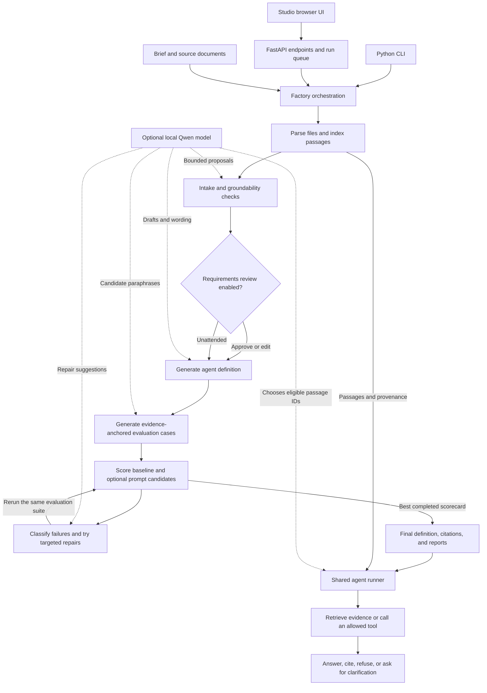
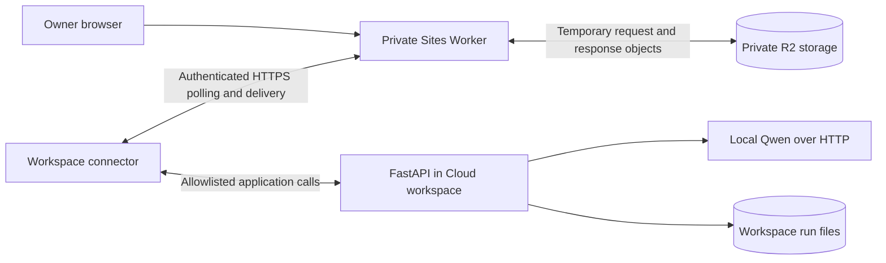

# ForgeAI Studio

ForgeAI Studio turns a short brief and a folder of documents into a runnable question-and-answer agent. It checks what those sources can support, writes an agent definition, generates an evaluation suite, and makes measured repairs. Each run produces inspectable evidence, including the final agent, source citations, per-case judgments, scorecards, and a report of remaining gaps.

The project implements the OceanAI **Agent That Builds Agents** assignment. It provides a browser workspace, a command-line interface, two distinct primary demonstrations, and two additional sample packs for tool coverage and regression testing.

## Contents

- [Problem and solution](#problem-and-solution)
- [Quick start](#quick-start)
- [Using Studio](#using-studio)
- [Architecture](#architecture)
- [How the factory works](#how-the-factory-works)
- [Runtime tools](#runtime-tools)
- [Technology stack](#technology-stack)
- [CLI and configuration](#cli-and-configuration)
- [Sample packs and measured results](#sample-packs-and-measured-results)
- [Outputs and API](#outputs-and-api)
- [Enterprise workflows](#enterprise-workflows)
- [Studio screenshots](#studio-screenshots)
- [Repository layout](#repository-layout)
- [Verification and limitations](#verification-and-limitations)

## Problem and solution

A team can have policies, catalogues, or operating procedures but still need to turn them into an assistant that knows which questions it can answer. That takes work beyond writing a prompt. The operator has to find coverage gaps, choose tools, verify citations, test refusals, and decide whether a change actually improved the agent.

ForgeAI automates that workflow. The inputs are a brief and a **corpus**, the collection of source documents. The output is a **declarative agent definition**, a JSON configuration that a shared runner can load to answer questions. ForgeAI measures that agent on a generated test suite and preserves the evidence behind the final result. The same runner answers questions in Studio, the CLI, and the evaluation loop.

The main design choice is to give the model bounded jobs such as drafting, proposing question wording, and suggesting which candidate passages to use. Python code enforces tool availability, verifies citations, grades the cases, and decides which repairs to keep. The factory can finish in a deterministic mode using templates and rules if the local model is unavailable.

## Quick start

Use Python **3.10 or newer** and Git. The first startup installs Python dependencies into a project-local virtual environment. With Git already available, run the following in a terminal.

```sh
git clone https://github.com/SrijanSingh2006/Ocean-AI-Assignment-ForgeAI.git
cd Ocean-AI-Assignment-ForgeAI
python launch.py
```

The launcher opens Studio at the address printed in the terminal, normally `http://127.0.0.1:8000`. It looks for a nearby free port if the default is occupied. Use `--port 8765` to prefer another port or `--no-browser` to print the address without opening a tab. Use `python3` or `py -3` where that is your Python command.

### Enable local Qwen inference

For the model-assisted workflow on **Linux x86-64**, launch with the model flag.

```sh
python launch.py --with-model
```

The first run downloads the official llama.cpp CPU build and about **491 MB** of Qwen weights. The script checks the model file against a pinned SHA-256 digest before using it. It starts the model server at `http://127.0.0.1:8089/v1`. The launcher reuses a compatible server if the configured endpoint is already responding. To keep the model in its own terminal, use `bash scripts/local-model.sh` and start Studio separately.

On **macOS or Windows**, start Ollama and pull the equivalent instruct model. Point ForgeAI at Ollama's OpenAI-compatible API, which accepts the same chat request format used by the local adapter.

```sh
ollama pull qwen2.5:0.5b
export FORGE_MODEL_URL=http://127.0.0.1:11434/v1
export FORGE_MODEL_NAME=qwen2.5:0.5b
python launch.py
```

For PowerShell, use `$env:FORGE_MODEL_URL = "http://127.0.0.1:11434/v1"` and `$env:FORGE_MODEL_NAME = "qwen2.5:0.5b"`. Restart or reload Studio after the local model is ready, then look for **Local model online** in the sidebar. The committed demonstrations were run with Qwen enabled. The **Offline runtime** badge indicates that deterministic processing is available.

## Using Studio

1. Open **Agent factory** and load a sample pack, or write a brief and upload your own files. A useful brief states the audience, the topics the agent should cover, and any topics it should refuse.
2. Choose the build settings. **Use local model** and **Prompt tournament** are enabled by default. Enable **Review requirements** to inspect or edit the proposed scope before generation. Leave it disabled for an unattended build.
3. Click **Build agent**. If review is enabled, check the source-coverage warnings. Edit the scope, audience, tone, or answer and refusal topics if needed, then approve. The factory reruns coverage checks against the same sources.
4. Inspect the completed report. **Overview** shows the score trend, budget, stopping reason, and remaining failures. **Evaluations** shows the expected evidence and answer for each case. **Comparisons**, when available, shows the tournament or hand-written comparison. **Definition**, **Requirements**, and **Run log** expose the configuration and decisions.
5. Use **Open chat** to try the generated agent and expand its citations. **Export run** downloads the brief, source documents, and the artifacts available for the run. **Run history** also opens the committed examples.

The moon icon switches between light and dark. The monitor icon follows the device theme. Studio persists the appearance preference in the browser, supports keyboard navigation and reduced motion, and provides a mobile navigation drawer.

## Architecture

### Application and factory



The web server accepts uploads and schedules builds on a single background worker. The browser polls the run status while the factory works. A review checkpoint pauses the run until approval or a ten-minute timeout. Local run state and artifacts use files on disk. CLI builds call the same Python factory directly.

### Hosted deployment

The hosted Studio serves the same browser interface under owner-only access. The browser sends application requests to a Sites Worker. The Worker temporarily stages requests and responses in Cloudflare R2, an object store. An authenticated connector in the running Cloud workspace claims those requests and forwards allowlisted operations to FastAPI. The workspace runs Qwen and stores completed runs.



The browser assets and FastAPI application live in this checkout. The Worker and connector are maintained as hosting configuration. Use the local launcher for review access from the public repository. The hosted workspace depends on its connected Cloud runtime and its owner-only sign-in. [Open the hosted Studio](https://forgeai-studio-project.blondebiscuit2.chatgpt.site/)

## How the factory works

### 1. Ingest documents and retain provenance

**Provenance** is the information needed to trace an answer back to the source. Every indexed passage records a normalized excerpt, an ID, its source file, a heading, and a locator such as a page, text block, or table row. The corpus loader walks supported files in a consistent path order.

| Input | Extraction approach |
| --- | --- |
| PDF | `pypdf` extracts the text layer page by page. Scanned pages require optical character recognition (OCR) before ingestion. |
| DOCX | `python-docx` reads headings and paragraphs. Table cells are rendered as labeled rows where a header is available. |
| CSV | Python detects comma, semicolon, or tab separators, reads headers, and keeps rows intact with their field names and row numbers. |
| Markdown and UTF-8 text | A heading-aware splitter groups paragraphs into sections and assigns text block locators. |

**Chunking** splits longer passages into searchable units. The original definition uses chunks of up to **135 words** with **24 words of overlap**, so a fact near a boundary can still appear with neighboring context. CSV rows remain whole. Input warnings appear in the requirements and report.

### 2. Identify requirements and check groundability

A request is **groundable** when a supplied passage or an enabled tool can provide evidence for it. The intake stage identifies the audience, tone, requested topics, and explicit exclusions. It proposes up to **five interview questions**. The optional model sees a bounded brief and file-heading inventory for this stage.

The guard ranks passages for each requested topic and measures **coverage**, the fraction of distinct query terms found in a passage body or its title and heading. At intake, a topic can be supported by a passage that meets the **0.55 coverage threshold** or by a matching registered tool. Weak matches become visible gaps. Gaps and explicit exclusions are carried into the definition's refusal rules.

Coverage is a lexical heuristic. A broad phrase can be flagged even when narrower questions work. The recorded Warehouse Tools run flags `sample inventory`, while a concrete SKU lookup such as `Look up BX-410` works against the supplied CSV. The requirements editor lets the operator replace vague labels and check the resulting requirements before generation.

### 3. Generate a portable agent definition

The factory saves a versioned JSON document. A **system prompt** specifies the agent's role and the evidence-selection behavior available to the model. The definition also carries enforcement settings used directly by the Python runner.

| Definition field | Purpose |
| --- | --- |
| `schema_version` | Selects the format the runner understands. |
| `system_prompt`, `audience`, `tone`, `scope` | Describe the role, intended readers, and supported work. |
| `denied_topics` and `tools` | Store explicit exclusions and registered tool names available to this agent. |
| `retrieval` | Stores chunk size and overlap, maximum selected passages, heading weight, coverage floor, and compound-query settings. |
| `policy` | Records clarification and verified evidence settings. |
| `output_contract` | Describes the fields and possible response statuses expected by clients. |

**Portable** means the shared runner can reuse `definition.json` with the same document collection. The definition stores settings and instructions. The source files supply the evidence, so keep them alongside an exported run.

The model adapter probes `/models` and submits bounded requests to `/chat/completions`. It requests a JSON object and records malformed responses or unavailable calls. The corresponding stage can continue with its rule-based output when a usable proposal is unavailable.

### 4. Retrieve evidence and answer

The runner uses **BM25**, a lexical ranking approach. BM25 rewards overlap with terms that are distinctive across the corpus and normalizes document length so that large passages gain less advantage from repeated words. ForgeAI weighs matches in the document title and section heading and computes coverage separately. `top_k` limits the final number of selected passages. The starting configuration uses one passage, a **0.36 minimum coverage**, and whole-question retrieval.

This is an **extractive form of retrieval-augmented generation (RAG)**. The runner retrieves source material, and the text it returns for document questions comes from those passages. The runner applies topic refusals and checks for common instruction-override wording in document requests. When several eligible passages rank closely, the local model may propose passage IDs. The runner accepts IDs from its own eligible candidates and renders the normalized source excerpts. After a compound-query repair, it can search each part separately to assemble a multi-source answer.

The **output contract** is shared by chat and evaluation. The possible statuses are `answered`, `refused`, `clarify`, and `error`. For document answers, the response contains exact citations. For an arithmetic, date, or weather result, `tool` identifies its source and `citations` can be empty. A CSV lookup returns matching rows with citations.

This example is from the recorded People Operations run.

```json
{
  "status": "answered",
  "answer": "Permanent shore employees receive 22 paid annual leave days per calendar year. Carryover is capped at five days and expires on 31 March of the next year.",
  "tool": null,
  "citations": [
    {
      "passage_id": "d02p001c01",
      "document": "Leave-Handbook.md",
      "heading": "Annual leave",
      "locator": "text, block 1",
      "quote": "Permanent shore employees receive 22 paid annual leave days per calendar year. Carryover is capped at five days and expires on 31 March of the next year."
    }
  ]
}
```

### 5. Generate the evaluation suite and grade it

An **evaluation case** is a question paired with an expected decision and, when answerable, source facts to verify. Every build creates **24 cases**. The generator samples distinct passages and derives **key facts** from source excerpts or CSV fields. It generates answerable, ambiguous, out-of-scope, and cross-document questions when distinct sources are available. Qwen can propose a small number of paraphrases. The generator accepts a paraphrase only when it preserves the source anchor and passes wording and answer-leak checks.

The **judge** is independent Python code. It verifies that cited passage IDs and documents exist, checks quotes against the stored passages, checks that the rendered answer consists of verified evidence, and matches expected facts in the correct source. It also checks the expected status, including refusal and clarification. A case passes only when its grounding and correctness checks pass. The **scorecard** reports the share of passing cases, with category and failure breakdowns. Tool behavior is also exercised separately from the document suite. Generated suite scoring suppresses external weather calls.

### 6. Compare prompts and repair failures

The **prompt tournament** evaluates three candidates against the same suite. **Grounded default** is the original prompt. **Exact evidence** favors the requested fact, and **Task coverage** favors evidence that covers all parts of a question. These variants change the model's evidence-selection preference while retaining the same grading rules. The winner has the most passing cases. A tie keeps the earlier candidate.

The **critic** classifies failed cases. The **optimizer** chooses an applicable edit from a registry of targeted repairs. A model can propose a repair, and the factory checks that proposal against the available candidates.

| Failure type | What it means in ForgeAI | Response |
| --- | --- | --- |
| Retrieval miss | An answerable case was refused, or the response omitted an expected source fact. | Search compound parts independently, retain more evidence, or tune heading weighting and coverage. |
| Prompt defect | A vague question received a decision other than the expected clarification. | Enable clarification when the question lacks a usable topic. |
| Hallucination | An answered case includes text or citations that fail the grounding check. | Use verified excerpts and consider a stricter evidence threshold. The runtime already renders verified excerpts by default. |
| Wrong refusal | A case expected to be refused received a different decision. | Adjust retrieval boundaries using the applicable registered repair. |

Each repair reruns the **same** cases. The factory records the previous and new settings, score difference, addressed cases, and cases that started failing. A patch is accepted only if it increases the total passes. The repair loop stops when all cases pass, a patch yields no net improvement, no repair applies, time expires, or the run reaches its limit of **three repair attempts**.

### 7. Apply budgets, compare results, and export evidence

- A **token budget** limits model usage. Tokens are units of text consumed or generated by the model. Before a call, the adapter reserves a conservative bound based on the prompt and requested output size. It records reported usage when available and uses the bound when necessary. A zero-token build uses deterministic processing.
- A **latency budget** limits active build time. The factory checks the deadline between work units and caps model request time by the remaining budget. Time spent waiting for a human review is excluded. If later work reaches the limit, the factory keeps the best complete scorecard and records interrupted stages. An expired run without a complete baseline reports the reason.
- A **hand-written baseline** is a separately authored agent definition. People Operations runs both definitions against the same corpus and questions with the same judge. The report lists case-level gains and losses.
- A **regression** is a test that previously passed and now fails. Regression mode runs the old questions and expected facts against the updated agent and sources. When the old results are available, it distinguishes newly failing cases from existing failures. This exposes changed policies that need a review of the old expectations.
- The factory exports portable JSON, a Markdown quality report, scored attempts, and the model trace. The final report includes source gaps, residual failures, and reasons for stopping.

## Runtime tools

A **tool registry** is the set of named functions the runner can invoke. The factory attaches tools by matching explicit requirements in the brief and checking prerequisites such as a readable CSV. At runtime, the requested operation must match an enabled tool. People Operations uses document retrieval alone. Marine Procurement enables CSV lookup and arithmetic, and Warehouse Tools enables all four.

| Tool | Example prompt | Operation |
| --- | --- | --- |
| `csv_lookup` | `Look up AF-310` | Searches rows from supplied CSVs and returns matching fields with source file and row citations. An unknown identifier returns a refusal. |
| `calculator` | `Calculate 3 * 46.50` | Parses bounded arithmetic in Python. It evaluates a restricted abstract syntax tree (AST), the parsed structure of the expression, with approved operators such as addition, multiplication, and division. |
| `current_date` | `What is today's date?` | Returns the host machine's calendar date in ISO format, `YYYY-MM-DD`. |
| `weather` | `Weather at 18.94, 72.83` | Validates latitude and longitude and requests current temperature and wind from Open-Meteo. The reply attributes the result, and the tool reports a lookup error if the service fails. |

## Technology stack

| Layer | Technology and role |
| --- | --- |
| Frontend | HTML, CSS, and vanilla JavaScript provide the Studio screens, run polling, report tabs, chat, and persistent themes. Node.js provides the optional development wrapper and syntax checks. |
| Server | Python 3.10+ contains the factory and runner. FastAPI implements HTTP routes. Pydantic validates structured request payloads, python-multipart reads file upload forms, and Uvicorn serves the application. |
| Document processing | `pypdf` and `python-docx` parse office formats. Python standard-library modules handle CSV, Markdown or text splitting, normalized evidence, JSON, and ZIP exports. |
| Search | An in-memory BM25-style index uses case-folded terms, stop-word filtering, document-frequency weights, and heading matches. |
| Model | Qwen2.5-0.5B-Instruct is a roughly half-billion-parameter instruction model. The bundled setup uses mixed 4-bit Q4_K_M weights in GGUF, a format llama.cpp can load. llama.cpp or Ollama exposes the chat API. |
| Storage and hosting | Local runs write file-based state, source documents, and artifacts. The optional private deployment uses a Sites Worker, temporary R2 objects, and a connector to the Cloud workspace. |
| Validation | `unittest` covers the factory and FastAPI routes. FastAPI's test client uses `httpx` for request testing. The network-backed weather tool can be exercised manually in Warehouse Tools. |

## CLI and configuration

For CLI work in the environment created by the launcher, activate it first. From a fresh checkout, create it and install the package if needed.

```sh
python -m venv .venv
source .venv/bin/activate
python -m pip install -e .
```

On Windows PowerShell, use `.\.venv\Scripts\Activate.ps1` for activation. The editable install makes `forgeai` available as a command and uses the checkout's code. The equivalent `python -m forgeai` commands below work from the project root.

### Build and chat

```sh
python -m forgeai build \
  --brief-file demos/people-ops/brief.txt \
  --docs demos/people-ops/documents \
  --out .runs/people-review \
  --baseline-definition demos/people-ops/manual-baseline.json

python -m forgeai chat \
  --definition .runs/people-review/definition.json \
  --docs demos/people-ops/documents \
  --ask "How much annual leave do permanent shore employees receive?"
```

Omit `--ask` for interactive chat. Enter `/exit` to leave it. Supply `--brief "..."` or `--brief-file path` to a build. Use `--interview` for terminal questions. A build writes to the folder given by `--out`. A single brief supports up to **4,000 characters**, and a build supports up to **30 supported files**, each up to **10 MiB**. The CLI reads nested source folders.

### Replay all samples or use a prior suite

```sh
python -m forgeai demo --all-samples --out .runs/reproduced

python -m forgeai build \
  --brief-file demos/people-ops-revised/brief.txt \
  --docs demos/people-ops-revised/documents \
  --regression-evals demos/people-ops/artifacts/evals.json \
  --out .runs/policy-regression
```

The replay command writes fresh artifacts, including the revised policy comparison. The regression command reads prior pass and fail results from a sibling `run.json` when present. In Studio, the **Revised People Operations** pack selects the original suite automatically. For other corpora, use **Set as regression baseline** on a completed report before building with the updated files.

### Controls and environment variables

| Setting | Default or usage |
| --- | --- |
| `--iterations` | `3` repair attempts. A value of `0` produces a baseline without the repair loop. |
| `--token-budget` | `12000` model tokens. Studio accepts `0` through `60000`. |
| `--latency-budget` | `120` seconds of active build time, configurable from `1` through `600`. |
| `--no-model` | Uses deterministic processing for the chosen CLI command. |
| `--no-tournament` | Scores the original prompt and skips alternate prompt candidates during a build. |
| `--baseline-definition` | Supplies a hand-written definition for comparison. |
| `FORGE_MODEL_URL` | Base URL for a compatible chat API, default `http://127.0.0.1:8089/v1`. |
| `FORGE_MODEL_NAME` | Model name sent to the server, default `qwen2.5-0.5b`. |
| `FORGE_RUN_DIR` | Web build storage directory, default `.runs/web/`. |
| `FORGE_RUNTIME_DIR` | Location for the Linux model assets, default `.runtime/`. |
| `FORGE_MODEL_PORT`, `FORGE_MODEL_THREADS` | Linux model server port and CPU threads, default `8089` and `2`. Set the corresponding `FORGE_MODEL_URL` when changing the model port. |

For manual web startup, run `python -m forgeai serve --host 127.0.0.1 --port 8000`. In a development environment with Node.js, `npm run dev` invokes the same server through the wrapper in [scripts/site-preview.mjs](scripts/site-preview.mjs).

## Sample packs and measured results

All committed sample records are fictional. Studio includes the briefs and source files. **Sample files** downloads the four packs with a guide. The repository includes the recorded Qwen artifacts so reviewers can inspect them immediately. [Sample guide and test prompts](demos/SAMPLE_GUIDE.md)

| Pack | What it demonstrates | Baseline → repair 1 → repair 2 | Evidence |
| --- | --- | --- | --- |
| People Operations | Policy passages across Markdown, PDF, and DOCX, an unsupported vessel-tracking topic, and a hand-written baseline | 18/24 → 22/24 → 24/24 | [Report](demos/people-ops/artifacts/report.md) |
| Marine Procurement | Catalogue, supplier availability, and purchase-basket CSVs with procurement documents and arithmetic | 18/24 → 22/24 → 24/24 | [Report](demos/marine-supply/artifacts/report.md) |
| Warehouse Tools | Inventory and shipment CSVs, operating procedures, and all four tools | 18/24 → 22/24 → 24/24 | [Report](demos/operations-lab/artifacts/report.md) |
| Revised People Operations | Updated leave and expense deadlines evaluated on new and prior questions | 18/24 → 22/24 → 24/24 | [Report](demos/people-ops-revised/artifacts/report.md) |

In the recorded runs, the two accepted edits were compound retrieval and vague-question clarification. In People Operations, all three tournament candidates tied at **18/24**, and **Grounded default** won by the tie rule. The final agent passed **24/24**, compared with **22/24** for the hand-written agent. Its two additional passing cases involved cross-document evidence. [Prompt comparison](demos/people-ops/artifacts/tournament.json) · [Hand-written comparison](demos/people-ops/artifacts/manual_comparison.json)

The revised policies changed annual leave from **22 to 25 days** and the travel reimbursement window from **30 to 45 calendar days**. The revised definition passed its newly generated suite. It passed **21/24 on the original suite**, with newly failing cases **E05**, **E11**, and **E14** identifying stale facts. [Regression evidence](demos/people-ops-revised/artifacts/regression.json)

## Outputs and API

### Artifacts

An **artifact** is a file that records what a run produced or measured. In Studio, each new run stores the uploaded sources, its brief, a status file, and the final artifacts under `.runs/web/<run_id>/`. For CLI builds, `--out` names the artifact directory. Each sample has its own committed `artifacts/` directory.

| File | What to inspect |
| --- | --- |
| `requirements.json` | Approved scope, audience, answer and refusal topics, coverage gaps, document inventory, and review edits. |
| `initial_definition.json` | Configuration selected as the starting point for targeted repair. |
| `definition.json` | The best completed definition used by the shared chat runner. |
| `evals.json` | Fixed evaluation questions, expected statuses, source documents, passage IDs, and key facts. |
| `eval_results.json` | Baseline and repair decisions, per-case outputs, and citations for each scored attempt. |
| `iterations.json`, `scorecards.json` | Attempted patches with before and after settings, accepted status, category totals, and stopping reason. |
| `tournament.json` | Prompt candidates, their case results, and the chosen starting prompt. Written when tournament mode is enabled. |
| `manual_comparison.json`, `regression.json` | Comparison with a supplied hand-written baseline or a prior suite, when configured and completed. |
| `model_trace.json` | Model call stages, returned JSON or error details, usage, skipped calls, and fallback indicators. |
| `report.md`, `run.json` | Human-readable summary and the aggregate result used by Studio. |

### Local HTTP API

FastAPI provides interactive OpenAPI documentation at `http://127.0.0.1:8000/docs` when the local server uses its default port. **OpenAPI** is a machine-readable description of the HTTP routes, inputs, and outputs.

| Method and route | Purpose |
| --- | --- |
| `GET /api/workspace` | Return the live model status, sample metadata, tool registry, and file limits. |
| `GET /api/runs` | List recorded samples and workspace runs. |
| `POST /api/runs` | Submit a multipart form containing a brief, files or the sample ID, and optional build settings. Returns HTTP `202` with an ID. |
| `GET /api/runs/{run_id}` | Poll status and retrieve a completed report. States include `queued`, `running`, `approval`, `complete`, and `failed`. |
| `POST /api/runs/{run_id}/approve` | Submit JSON containing interview `answers` and/or requirements `edits` for a run waiting on review. |
| `POST /api/chat` | Send JSON with `run_id` and `question`. The server loads the completed definition and its source files. |
| `GET /api/runs/{run_id}/artifact/{name}` | Fetch one allowed artifact from a completed run. |
| `GET /api/runs/{run_id}/download` | Export the run artifacts, documents, and brief as a ZIP. |
| `GET /sample-documents`, `GET /project-download` | Export the sample packs or the runnable project. |

With Studio running locally, query the committed People Operations agent without starting a new build.

```sh
curl -fsS http://127.0.0.1:8000/api/chat \
  -H 'Content-Type: application/json' \
  -d '{"run_id":"people-ops","question":"What does Leave Handbook document about Annual leave?"}'
```

## Enterprise workflows

Run **Blind evaluation** and **Security conformance** from the factory’s **Evaluation and evidence** settings. The ordinary build keeps its 24-case suite. Blind mode generates 32 cases, stratifies by question category, and keeps 24 in development and eight in a held-out suite. The factory selects prompts and repairs on development data, then scores the holdout once and writes separate result files. For an independent project brief and document collection, upload those files and select **New corpus**. The report identifies the corpus origin. The [replay evidence](demos/enterprise-evidence/README.md) includes both paths.

Open **Engineering lab** on a completed run to inspect its workflow reports. **Dashboard** shows metrics from workspace builds, together with pending reviews and feedback. Recorded sample runs are counted separately.

| Workflow | How to use it |
| --- | --- |
| Source conflicts | Compare numeric claims for comparable topics. Each claim points to a document and locator. An admin selects the applicable source and records a reason. Chat asks for clarification while the conflict is unresolved. |
| Execution traces | Open a chat trace to inspect retrieval candidates, selected evidence, tool decisions, verification, and timing. Traces redact recognized patterns for personal data and credentials before storage. Admins can delete traces. |
| Security checks | Run fixed, offline conformance checks for disabled tools, protected prompt content, input validation, and exclusion of instruction-like passages. |
| Model comparison | Benchmark server-configured compatible model profiles against the same development cases. The report displays quality, latency, tokens, and cost when usage and pricing are available. A model must contribute to scoring and meet the quality floor to qualify. |
| Language evaluation | In chat, choose automatic, English, Hindi, or Tamil. Cross-language answers are verified by numeric and identifier checks and a round trip back to the source language. Citations retain the original text. The lab distinguishes scored, unavailable, and unverified cases. |
| Feedback review | Submit feedback from chat. An admin verifies the expected decision and any cited passages before promoting a case to development or regression. Repair suggestions are scored before anyone applies a change. |
| Document impact | Compare two runs to see changed sources and affected passages and cases. Inspect verified links, run targeted checks, and optionally rerun the full prior suite. |
| Releases and export | Create an immutable snapshot, approve it, and activate it. Compare snapshots or roll back to recover both the previous definition and the previous sources. Export the active agent as a standalone ZIP. |
| Confidence calibration | Supply disjoint labeled training and validation JSON arrays. Each row has an `id`, a numeric `score`, a Boolean `correct`, and a `status` of `answered`, `refused`, or `clarify`. The report shows reliability by band, a Brier score, answer coverage, and error rates. Runtime evidence scores are heuristic. |
| OCR and source provenance | Enable Tesseract for PNG and JPEG images, scanned PDF pages, and embedded images in DOCX paragraphs. PDF text layers, DOCX paragraphs and tables, and CSV rows retain their native extraction. OCR citations record coordinates and confidence. |

### Enterprise architecture

```mermaid
flowchart LR
    Studio["Studio and FastAPI"] --> Access["Session, role and source access"]
    Access --> Factory["Shared factory"]
    Access --> Runner["Shared agent runner"]
    Files["Files and OCR passages"] --> Factory
    Factory --> Dev["Development cases and repairs"]
    Dev -->|Final definition| Blind["Held-out evaluation"]
    Dev --> Runs["Run artifacts"]
    Blind --> Runs
    Runs --> Releases["Release snapshots and agent export"]
    Releases -->|Active definition and frozen sources| Runner
    Access --> Ops["Engineering workflows"]
    Runner --> Retrieval["Lexical retrieval, optional embeddings, tools"]
    Retrieval --> Verify["Source, conflict and evidence checks"]
    Verify --> Chat["Answer, refuse or clarify"]
    Verify --> Trace["Redacted execution trace"]
    Chat --> Feedback["Reviewed feedback cases"]
    Feedback --> Dev
    Ops --> Runs
    Ops --> Releases
```



Run folders hold source files, scorecards, traces, and exports. SQLite, Python's embedded relational database, stores reviewed feedback and release metadata. Release snapshots include source fingerprints and the extracted passages used during the release. The API and CLI share the same validation and retrieval code. The existing hosted build and this local enterprise branch have separate deployment paths.

### Configuration

| Setting | Purpose |
| --- | --- |
| `FORGE_RUN_DIR` | Set the writable root for Studio runs and enterprise workspace data. The default is `.runs/web`. |
| `FORGE_AUTH_CONFIG` | Enable local sign-in from a JSON user configuration file. With the setting unset, Studio uses the original single-user local mode. |
| `FORGE_COOKIE_SECURE=1` | Require HTTPS for the session cookie. Configure it when serving through a TLS reverse proxy. |
| `FORGE_TRACE_RETENTION_DAYS` | Retain traces for 1–365 days, default 30. Expired traces are excluded from reads and cleaned up when new traces are stored for that run. |
| `FORGE_OCR=1` | Enable OCR. Install Tesseract and, for scanned PDFs, Poppler’s `pdftoppm`. Set `FORGE_OCR_LANGUAGES` to installed Tesseract codes such as `eng+hin+tam`. |
| `FORGE_LANGUAGE_MODEL_NAME`, `FORGE_LANGUAGE_MODEL_URL`, `FORGE_LANGUAGE_MODEL_API_KEY` | Configure an optional compatible translation model. Keep its credential in the environment. |
| `FORGE_EMBEDDING_URL`, `FORGE_EMBEDDING_MODEL`, `FORGE_EMBEDDING_API_KEY` | Configure optional semantic retrieval through an OpenAI-compatible embeddings endpoint. Lexical retrieval remains available when the provider is unavailable. |
| `FORGE_MODEL_PROFILES` | JSON array of up to five entries. Each sets `id`, `url`, and `model`, with optional `api_key_env` and `price_per_million_tokens`. |

For local authorization, copy [access.example.json](docs/access.example.json) to a private path, then generate a fresh salted PBKDF2 password hash for each account.

```bash
python -c 'from getpass import getpass; from forgeai.privacy import password_hash; print(password_hash(getpass()))'
export FORGE_AUTH_CONFIG=/absolute/path/to/private-access.json
python -m forgeai serve --host 127.0.0.1 --port 8000
```

Replace each placeholder hash in the private configuration. An admin can build and manage agent releases. A reviewer can inspect authorized runs and can approve requirements or releases when `can_approve` is enabled. A user can chat with authorized agents and submit feedback. Optional `agents` and `documents` arrays restrict access by run ID and filename. The API checks the complete collection so answers, citations, reports, and exports share the same source permissions. The local mode uses eight-hour sessions in a single server process and is intended for a trusted host.

### Enterprise API

FastAPI’s [local OpenAPI explorer](http://127.0.0.1:8000/docs) exposes the request and response schemas. With authorization configured, Studio obtains a session cookie before calling protected endpoints. When calling the API directly, keep and reuse the returned cookie.

| Route | Purpose |
| --- | --- |
| `GET /api/health` and `GET/POST/DELETE /api/session` | Check startup and inspect, start, or end a session. |
| `GET /api/dashboard` | Read metrics for permitted workspace builds. |
| `POST /api/runs` | Build from multipart fields. Optional fields are `blind`, `unseen_corpus`, `security_audit`, and `minimum_confidence`. |
| `POST /api/chat` | Send `run_id`, `question`, and optionally `language`. The reply includes citations, evidence confidence when applicable, and a trace ID. |
| `GET /api/runs/{id}/conflicts` and `POST /api/runs/{id}/conflicts/{conflict_id}` | Inspect claims and record an applicable passage and reason. |
| `GET /api/runs/{id}/traces` and `GET/DELETE /api/runs/{id}/traces/{trace_id}` | List, read, or delete a retained execution trace. |
| `GET/POST /api/runs/{id}/security`, `/models`, `/languages`, and `/impact` | Read or generate the corresponding analysis. |
| `GET/POST /api/runs/{id}/feedback` and `POST /api/runs/{id}/feedback/{feedback_id}/review` | Submit trace-linked feedback, inspect the queue, and validate test cases. |
| `GET/POST /api/runs/{id}/releases`, `POST /api/runs/{id}/releases/{version}/{operation}`, and `GET /api/runs/{id}/release-diff` | List, freeze, approve, activate, roll back, or compare snapshots. |
| `GET /api/runs/{id}/deployment` | Export the runnable agent and its ready-to-load source index. |
| `POST /api/confidence/calibration` | Calculate confidence reliability from separate labeled datasets. |

### Deploy a standalone agent

In **Engineering lab → Releases and export**, select **Export runnable agent**. Follow the README inside the ZIP for a fresh Python environment or Docker Compose. The generated service provides `GET /health` and `POST /chat`. Set `FORGE_DEPLOY_TOKEN` to require bearer authentication, and keep the ZIP and token with users authorized to see all bundled sources. The export contains source hashes and indexed evidence, allowing scanned documents to work without an OCR engine at serving time.

### Verification and open items

The [enterprise verification report](docs/enterprise-upgrade.md) records feature status, the full test commands, and the recruiter walkthrough. Qwen 2.5 0.5B passed English in the small language replay. Hindi failed verification and Tamil was unavailable. Reliable multilingual operation requires a compatible provider validated on representative questions. The benchmark had one live model profile, and the measured sample completed through deterministic retrieval. Semantic provider integration was tested with controlled responses.

Conflict detection covers comparable numeric claims. OCR handles source text and provenance. Chart and figure interpretation and complex document layout recognition remain open. Security testing covers the fixed conformance suite and static source scanning. Confidence scores express heuristic evidence quality, with calibration results reported separately on user-supplied labeled data.

## Studio screenshots

The screenshots below were captured from the running branch in Chromium. Open the [blind evaluation](docs/screenshots/blind-results.jpg), [execution trace](docs/screenshots/execution-trace.jpg), [workspace dashboard](docs/screenshots/dashboard.jpg), and [mobile dashboard](docs/screenshots/dashboard-mobile.jpg).

| Light | Dark |
| --- | --- |
|  |  |

## Repository layout

```text
ForgeAI/
├── forgeai/
│   ├── cli.py          Command-line build, chat, replay, and server commands
│   ├── corpus.py       File extraction, passage provenance, and BM25 search
│   ├── factory.py      Intake, definitions, evaluations, repairs, and reports
│   ├── model.py        Local chat API adapter, fallback, and budget accounting
│   ├── registry.py     Tool selection and four runtime operations
│   └── web.py          FastAPI routes, background jobs, and ZIP exports
├── static/             Studio HTML, styles, JavaScript, theme, and images
├── prompts/            Prompts for intake, design, evidence, evaluation, and critic
├── demos/              Fictional source packs, briefs, and recorded run artifacts
├── scripts/            Linux model setup and development server wrapper
├── tests/              Unit tests and HTTP workflow checks
├── launch.py           Local dependency setup and browser launcher
└── pyproject.toml      Python package metadata and dependency ranges
```

The `prompts/` directory includes the question paraphrasing, tournament, and repair instructions. It also contains the sample data synthesis prompt. This lets reviewers inspect the model's role in the pipeline alongside the code that verifies its outputs. [Pipeline prompts](prompts/) · [Sample synthesis prompt](prompts/demo_synthesis.txt)

## Verification and limitations

Install the test dependencies and run the suite from the repository root.

```sh
python -m pip install -e '.[test]'
python -m unittest discover -s tests -v
node --check static/app.js
node --check static/theme.js
```

The automated checks cover a separate exhibition-policy corpus, unsupported scope, PDF/DOCX/CSV extraction, citation integrity, tool selection and dispatch, token and latency limits, a repair with no score gain, regression after a source edit, and the HTTP path from upload and edited approval to grounded chat and ZIP export. The sample guide includes steps for exercising the recorded browser workflows and all four tools. [Sample guide](demos/SAMPLE_GUIDE.md)

| Area | Current boundary |
| --- | --- |
| Evaluation | The generated suite and optimizer use the same corpus. Scores measure those specific cases. A separate collection and independently written questions are needed to measure generalization. |
| Retrieval and coverage | Term matching can miss synonyms, paraphrases, or indirect evidence. Extractive responses may be longer than a human-written answer. Broad topics benefit from concrete terminology in the brief. |
| Document extraction | Scanned PDFs need OCR. Complex layouts and broken files can reduce extractable evidence. The report lists ingestion warnings. |
| Budget and concurrency | A local build queue processes one build at a time. A parser can finish its current operation before the next deadline check. Restarting the server can interrupt unfinished jobs. |
| Runtime tools | Weather depends on Open-Meteo availability. The date comes from the runtime host. Installed model versions, system resources, and budgets can affect candidate scoring and reproduction. |
| Deployment and data | The Python app is designed for a single-user workspace. Run it on loopback for private documents. Exported run ZIPs contain their source files. The owner-private hosted instance needs its running workspace and connector. |

The committed reports preserve limitations and case-level outcomes even when a generated suite reaches 100%. [Browse the recorded demonstrations](demos/)
