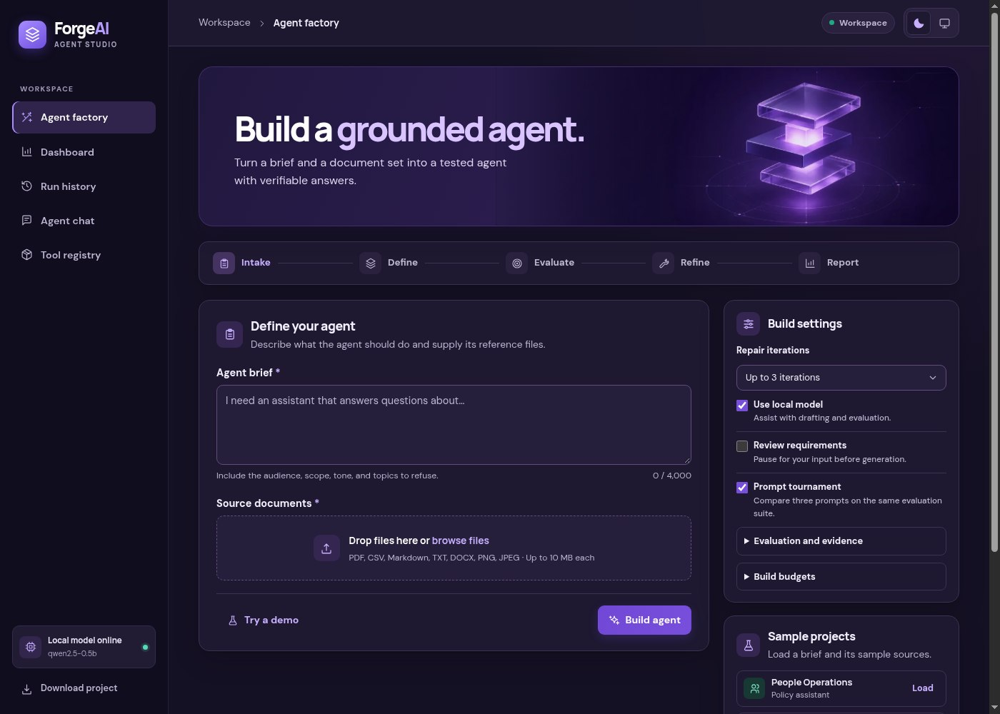
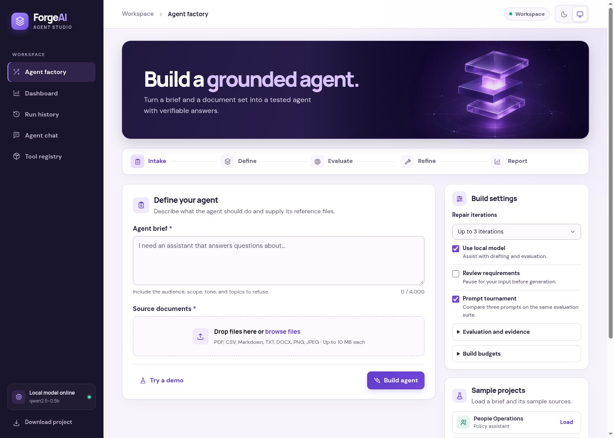
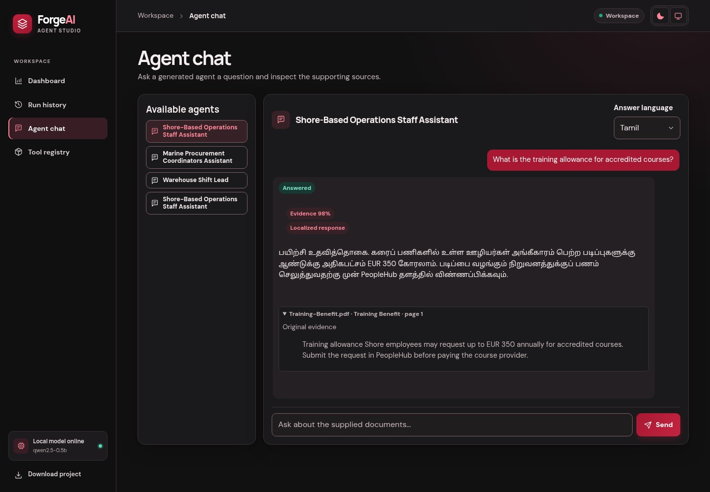

# ForgeAI Studio

ForgeAI turns a short brief and a document collection into a runnable, tested question-answering agent. It identifies what the sources can support, builds an agent definition, generates evidence-based evaluations, and applies targeted repairs. Each build preserves the definition, test cases, scorecards, source citations, and unresolved gaps.

[Sample documents and test questions](demos/SAMPLE_GUIDE.md) · [Verification and evidence](docs/verification.md) · [Docker and Render deployment](docs/deployment.md) · [Recorded walkthrough](https://raw.githubusercontent.com/SrijanSingh2006/Ocean-AI-Assignment-ForgeAI/5c3e9954980dc7294620d44df8ec7b36b08bb196/ForgeAI-Studio-Demo.mp4)

## Problem and approach

Teams often have handbooks, catalogs, or operating procedures and need an assistant that stays within those sources. Building one requires deciding which questions are answerable, attaching the right tools, validating citations, and checking whether changes make the answers better.

ForgeAI automates that workflow. A brief defines the goal, audience, scope, tone, and exclusions. A shared runner loads the resulting JSON definition and the indexed source passages. Optional models draft bounded proposals such as question wording and candidate passage IDs. The factory validates those proposals, applies access and evidence rules, and grades every evaluation case with deterministic checks. The factory and the runner also have a deterministic mode for local use without a model endpoint.

## Quick start

Use Git and Python 3.10 or newer. The launcher creates a local virtual environment, installs dependencies, and starts Studio on loopback. Follow the address it prints, normally `http://127.0.0.1:8000`.

~~~sh
git clone --branch enterprise/incremental-upgrade https://github.com/SrijanSingh2006/Ocean-AI-Assignment-ForgeAI.git
cd Ocean-AI-Assignment-ForgeAI
python launch.py
~~~

Use `--port 8765` to prefer another port or `--no-browser` to keep startup in the terminal. For a manual setup, run `python -m pip install -e .` in your virtual environment and then `python -m forgeai serve --host 127.0.0.1 --port 8000`.

To enable Qwen2.5-0.5B-Instruct with the bundled llama.cpp launcher on Linux x86-64, run `python launch.py --with-model`. The first startup downloads the CPU runtime and about 491 MB of weights, then checks the model digest. On macOS or Windows, use Ollama with `ollama pull qwen2.5:0.5b`, set `FORGE_MODEL_URL=http://127.0.0.1:11434/v1` and `FORGE_MODEL_NAME=qwen2.5:0.5b`, and launch Studio. [Models and deployment settings](docs/deployment.md#models-and-document-tools)

## Use Studio

1. Open **Agent factory**. Load a sample pack or enter a brief and upload PDF, DOCX, CSV, Markdown, or text files. A brief can contain up to 4,000 characters. Each build can use up to 30 files of 10 MiB each.
2. Set the model, evaluation, and budget options. Enable **Review requirements** to answer up to five questions, review gaps, or edit the proposed audience and scope before generation. Leave it off for an unattended run.
3. Select **Build agent**. The run report shows evaluation cases, expected source facts, the actual responses, repair attempts, and the stopping reason. **Comparisons** shows prompt candidates or the manual baseline when available.
4. Open **Chat**, ask a question, and expand the citation to see the original evidence. Use the answer-language selector for English, Hindi, or Tamil. Use **Engineering lab** to inspect traces, review conflicts or feedback, compare versions, or export a runnable agent.

The moon button switches between light and dark. The system option follows the device theme. The interface stores the preference in the browser and supports keyboard navigation, mobile navigation, and reduced motion.

### Sample runs

| Sample | Quick check |
| --- | --- |
| [People Operations](demos/people-ops/) | Ask how much annual leave permanent shore employees receive. The answer cites the 22-day rule in the leave handbook. The report includes a prompt tournament, a manual baseline, and language results. |
| [Marine Procurement](demos/marine-supply/) | Ask `Look up AF-310` to retrieve a CSV row, or ask for an unknown SKU to verify refusal. |
| [Warehouse Tools](demos/operations-lab/) | Ask `Look up BX-410`, `Calculate 12 * 8`, or `What is today's date?`. The configured weather tool uses a keyless Open-Meteo request in a network-enabled workspace. |
| [Revised People Operations](demos/people-ops-revised/) | Compare updated leave and travel policies with the original evaluation. The earlier expectations can fail when the source policy changes. |

The fictional sources, sample artifacts, and expected checks are part of the repository. From a running Studio, `/sample-documents` downloads the bundled input files. [Sample guide](demos/SAMPLE_GUIDE.md)

## Architecture

~~~mermaid
flowchart TB
    subgraph Access["Clients and access"]
        Guest["Public browser · sample reports, chat and export"]
        Staff["Signed-in Studio · admin, reviewer and user roles"]
        CLI["Local Python CLI"]
        API["FastAPI · request validation, sessions, roles, source access"]
        Guest --> API
        Staff --> API
    end

    subgraph Build["Agent factory"]
        Queue["Background queue · status and review checkpoint"]
        Parse["Document parsers · PDF, DOCX, CSV, text, OCR and figures"]
        Intake["Intake · requirements, coverage gaps and exclusions"]
        Definition["Agent definition · prompt, retrieval, tools and output contract"]
        Eval["Evaluation · generation, independent judge and scorecards"]
        Repair["Prompt tournament, bounded repairs, holdout and regression"]
        Queue --> Parse --> Intake --> Definition --> Eval --> Repair
    end

    subgraph Chat["Shared agent runtime"]
        Language["Language detection and query normalization"]
        Search["Section-weighted BM25, optional E5 and permitted tools"]
        Verify["Source, conflict, evidence confidence and translation checks"]
        Reply["Answer, clarify or refuse · original citations"]
        Language --> Search --> Verify --> Reply
    end

    subgraph Ops["Reports and operations"]
        Lab["Dashboard and lab · diagnostics, calibration, comparisons and impact"]
        Review["Review evidence conflicts, feedback and candidate test cases"]
        Release["Freeze, approve, activate or roll back releases"]
        Export["Download source packs, run reports and standalone agents"]
        Lab --> Review
        Lab --> Release --> Export
    end

    subgraph Data["Storage and model adapters"]
        Runs[("Documents, passage index, run JSON, scorecards and redacted traces")]
        DB[("SQLite workspace metadata, reviewed feedback and releases")]
        Models["Optional Qwen or compatible chat endpoint; NLLB translation; E5 embeddings"]
    end

    API --> Queue
    API --> Language
    API --> Lab
    CLI --> Parse
    CLI --> Language
    Parse --> Runs
    Repair --> Runs
    Repair -->|Selected definition| Language
    Runs --> Search
    Verify -->|Redacted decision events| Runs
    Review --> DB
    Review -->|Approved cases| Eval
    Release --> DB
    Release -->|Frozen sources and active definition| Language
    Runs --> Lab
    Runs --> Export
    Models -.-> Intake
    Models -.-> Eval
    Models -.-> Search
    Models -.-> Verify
~~~

On Render, one non-root Docker service serves the static interface and APIs on the same origin. The service listens on the platform's `PORT` and exposes `/api/health`. The free reviewer profile reads bundled fictional sources. An owner deployment uses an authorization file, a writable volume for `/data`, and optional configured model endpoints. [Deployment details](docs/deployment.md)

~~~mermaid
flowchart LR
    Git["GitHub branch · Dockerfile and render.yaml"] --> Build["Render build"]
    Build --> Image["Versioned Docker image"]
    Visitor["Browser"] -->|HTTPS| Proxy["Render routing and health check"]
    Proxy -->|PORT| App["Uvicorn · static assets and FastAPI"]
    Image --> App
    App --> Samples[("Bundled sample sources and reports")]
    App -->|Authenticated owner profile| Volume[("Persistent /data · run files and SQLite")]
    Secrets["Platform secrets · auth and provider settings"] --> App
    App -.->|When configured| Providers["Private or external model endpoints"]
~~~

### Build, score, and repair

- **Ingestion** preserves file names, page, paragraph or row locators, and normalized passage text. The default index uses 135-word windows with 24 words of overlap. CSV rows stay intact. Optional OCR and labeled bar-chart extraction add provenance for supported visual sources.
- **Groundability** means the requested topic has supporting source evidence or a permitted tool. Intake uses lexical coverage and a distinct semantic match when embeddings are configured. Unsupported topics appear in the requirements and carry into the refusal policy.
- **Evaluation** generates 24 development cases with grounded, ambiguous, refusal, and cross-document questions when the collection supports them. The judge checks status, passage ID, document, heading, locator, exact quote, and expected facts. Blind evaluation holds eight cases apart from development and scores them after tuning.
- **Optimization** compares up to three prompt candidates on the same suite and attempts at most three targeted repairs. A repair can change evidence coverage, heading weight, compound retrieval or clarification behavior. A patch is kept when it improves the score within the token and latency budgets. Scorecards track each attempt and remaining failures.
- **Regression** replays prior cases against a new definition and corpus. The lab connects changed evidence to affected cases and keeps the prior outcomes visible.

### Answer and citation flow

~~~mermaid
sequenceDiagram
    participant Browser as Browser or CLI
    participant Runner as Agent runner
    participant Index as Source index and tool registry
    participant Models as Optional translation and embedding adapters
    participant Store as Workspace trace store
    Browser->>Runner: Question, run or release, and language preference
    Runner->>Runner: Check access, exclusions, and input language
    Runner->>Index: Rank eligible passages or dispatch an enabled tool
    opt Semantic retrieval or translation
        Runner->>Models: Original-script search or bounded translation
        Models-->>Runner: Candidate evidence or translated text
    end
    Index-->>Runner: Source evidence or tool result
    Runner->>Runner: Verify facts and qualifiers or abstain
    opt Authorized workspace chat
        Runner->>Store: Retain redacted retrieval and decision events
    end
    Runner-->>Browser: Decision, answer and separate original evidence
~~~

BM25 uses term overlap, rarity, and document length to rank passages. The optional multilingual E5 index can compare queries across scripts. Replies use matching aligned sample text or a verified translation when configured. Numeric values, identifiers, and supported policy qualifiers are checked, and original source quotes remain available.

The registry offers CSV lookup, a calculator, the host date, and Open-Meteo weather. The factory selects tools from the brief and available sources. The public reviewer profile runs without outbound tool requests. The owner profile can exercise live weather.

## Technology stack

| Layer | Technology |
| --- | --- |
| Interface | HTML, CSS, and JavaScript with asynchronous API calls, a responsive sidebar, and persistent themes |
| API and execution | Python 3.10+, FastAPI, Pydantic, Uvicorn, and a single background build worker |
| Document handling | pypdf, python-docx, Python CSV and text parsing, optional Tesseract, Poppler and Pillow |
| Search and generation | Section-weighted BM25, optional E5 through ONNX Runtime, Qwen through llama.cpp or Ollama, compatible chat and embedding endpoints |
| Translation | NLLB through CTranslate2 and SentencePiece with source-aligned sample passages and translation checks |
| Storage | Run files, original sources, source fingerprints, SQLite workspace metadata and versioned release snapshots |
| Validation and hosting | unittest, httpx, Chromium, Docker and a Render Blueprint |

## CLI and API

~~~sh
python -m forgeai build \
  --brief-file demos/people-ops/brief.txt \
  --docs demos/people-ops/documents \
  --out .runs/people-review --blind

python -m forgeai chat \
  --definition .runs/people-review/definition.json \
  --docs demos/people-ops/documents \
  --ask "How much annual leave do permanent shore employees receive?"

python -m forgeai demo --all-samples --out .runs/reproduced
~~~

Use `--interview` for terminal clarification, `--no-model` for deterministic builds, `--regression-evals` to replay prior cases, and `--token-budget` or `--latency-budget` to limit runs. Omit `--ask` for interactive chat. Run `python -m forgeai --help` for the complete CLI and open `/docs` on the running local service for its OpenAPI contract.

| Route | Purpose |
| --- | --- |
| `/api/session`, `/api/workspace`, `/api/health` | Authentication, available samples and tools, and process health |
| `POST /api/runs`, `GET /api/runs/{id}`, `POST /api/runs/{id}/approve` | Start a build, poll or read its report, and submit requirements review |
| `POST /api/chat` | Send `run_id`, `question` and optional `language` to the selected agent |
| `/api/runs/{id}/artifact/{name}`, `/download`, `/deployment` | Read a report artifact, download a run, or export a standalone agent |
| `/api/runs/{id}/conflicts`, `/traces`, `/feedback`, `/impact`, `/releases` | Engineering workflow routes scoped to the run and signed-in permissions |
| `/api/runs/{id}/security`, `/models`, `/languages`, `/api/confidence/calibration` | Defensive checks, model and language evaluation, and confidence measurement |

Exports contain the definition, sources and available evidence. A standalone agent also contains a frozen source index, source hashes and a runner. Its local API offers `GET /health` and `POST /chat`. Set `FORGE_DEPLOY_TOKEN` to require bearer authentication before sharing an exported service.

## Verification and screenshots

~~~sh
python -m pip install -e '.[test]'
python -m unittest discover -s tests -v
node --check static/app.js
node --check static/enterprise.js
node --check static/theme.js
~~~

The suite covers the factory, citations, OCR, feedback, releases, downloads and workspace isolation. The recorded unseen-corpus audit ran an aquarium brief through Qwen and passed 24 development and 8 holdout cases. Those scores describe the tested inputs. [Test evidence and current limitations](docs/verification.md)

| Light theme | Tamil chat with original source citation |
| --- | --- |
|  |  |

[Reviewer home](docs/screenshots/reviewer-home.jpg) · [Language evaluation](docs/screenshots/reviewer-language-evaluation.jpg) · [Blind evaluation](docs/screenshots/blind-results.jpg) · [Execution trace](docs/screenshots/execution-trace.jpg) · [Desktop dashboard](docs/screenshots/dashboard.jpg) · [Mobile dashboard](docs/screenshots/dashboard-mobile.jpg)

## Repository layout

~~~text
forgeai/     Factory, indexed corpus, chat runtime, API, and release services
static/      Browser interface and themes
prompts/     Versioned runtime and evaluation prompts
demos/       Fictional inputs, sample guides, and recorded runs
docs/        Deployment, verification, screenshots, and measured evidence
scripts/     Local model setup and reproducible checks
tests/       Unit and integration tests
Dockerfile  Portable application image
render.yaml Public reviewer deployment
~~~
